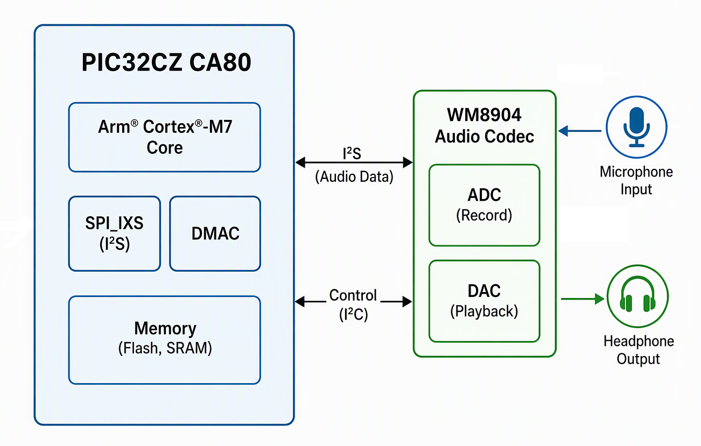
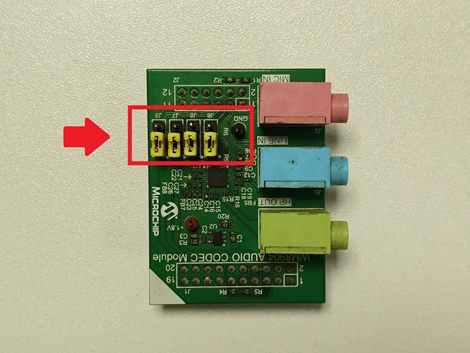
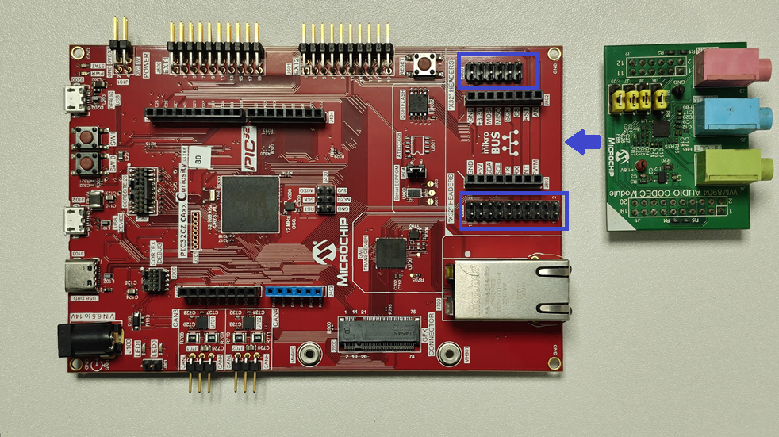
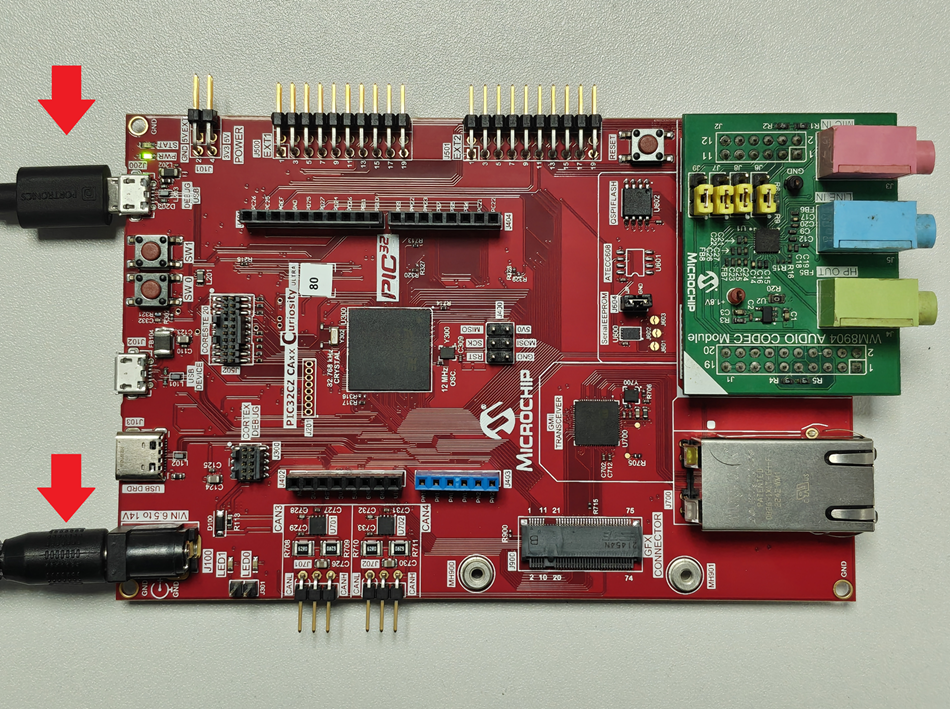
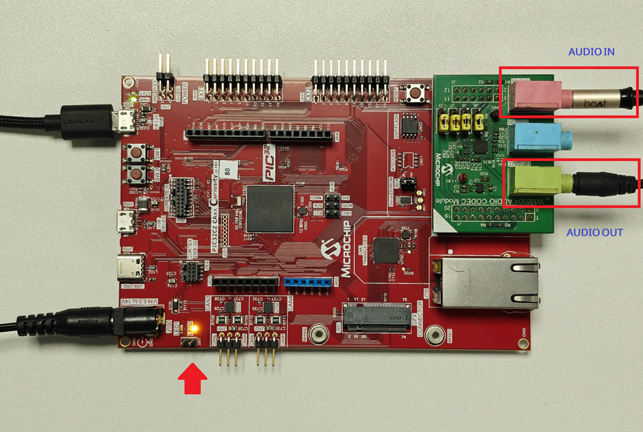

<!-- Please do not change this logo with link -->

<a target="_blank" href="https://www.microchip.com/" id="top-of-page">
   <picture>
      <source media="(prefers-color-scheme: light)" srcset="images/mchp_logo_light.png" width="350">
      <source media="(prefers-color-scheme: dark)" srcset="images/mchp_logo_dark.png" width="350">
      
   </picture>
</a>

# Real-Time Audio Loopback Using the Arm® Cortex®-M7-Based PIC32CZ CA80 Microcontroller

The PIC32CZ CA80 microcontroller family, based on the Arm® Cortex®-M7 core, is built for high-performance embedded applications. It integrates a comprehensive set of peripherals, including the Serial Peripheral Interface with Inter-IC Sound (SPI_IXS) module and a multi-channel Direct Memory Access Controller (DMAC), making it well suited for audio processing and streaming applications.

This application example shows real-time audio streaming on the PIC32CZ CA80 Curiosity Ultra board using the WM8904 audio codec. The application implements a bidirectional audio loopback that captures audio from the microphone input and routes it to the headphone output. It uses the SPI_IXS peripheral in I²S host mode, the DMAC for audio data transfer without CPU intervention, the Timer/Counter for Control (TCC) as the system time base, the Serial Communication Interface (SERCOM)-based Universal Synchronous Asynchronous Receiver Transmitter (USART) for status messages, and General Purpose Input/Output (GPIO) for a heartbeat LED.

   <p align="left">
     
     <br><b>Figure 1.</b> Block Diagram
   </p>
  <p></p>

## Related Documentation
- [PIC32CZ CA80 Product Page](https://www.microchip.com/en-us/products/microcontrollers/32-bit-mcus/pic32-sam/pic32cz-ca)
- [PIC32CZ8110CA80208 Product Page](https://www.microchip.com/en-us/product/PIC32CZ8110CA80208)
- [PIC32CZ CA80 Curiosity Ultra Development Board User Guide](https://ww1.microchip.com/downloads/aemDocuments/documents/MCU32/ProductDocuments/UserGuides/PIC32CZ-CA80-CA90-Curiosity-Ultra-User-Guide-DS70005522.pdf)
- [WM8904 Audio Codec Daughter Board User Guide](https://ww1.microchip.com/downloads/aemDocuments/documents/OTH/ProductDocuments/Brochures/PIC32-Audio-Codec-Daughter-Board-WM8904-Information-Sheet-DS50002775A.pdf)

## Software Used
- [MPLAB® Tools for VS Code®](https://www.microchip.com/en-us/tools-resources/develop/mplab-tools-vs-code) v1.2.8 or newer
- [MPLAB® XC32](https://www.microchip.com/en-us/tools-resources/develop/mplab-xc-compilers/xc32) v6.00 or newer
- [MPLAB® Code Configurator (MCC)](https://www.microchip.com/mplab/mplab-code-configurator) v5.7.1 or newer
- [Microchip PIC32CZ-CA80 Series Device Support (DFP)](https://packs.download.microchip.com/) v1.7.219 or newer
- [MPLAB® Data Visualizer](https://www.microchip.com/en-us/tools-resources/debug/mplab-data-visualizer)
- CMSIS v6.3.0 or newer
- CSP v3.26.0 or newer
- Harmony Core v3.17.0 or newer
- MCC Core v5.9.1 or newer

## Hardware Used
- [PIC32CZ CA80 Curiosity Ultra Development Board (EV16W43A)](https://www.microchip.com/en-us/development-tool/EV16W43A)
- [WM8904 Audio Codec Daughter Board (AC328904)](https://www.microchip.com/en-us/development-tool/AC328904)
- Microphone or audio source with a 3.5 mm jack
- Headphones or speakers with a 3.5 mm jack

## Application Setup
All peripheral and clock configurations for this example are generated using MPLAB® Code Configurator (MCC) inside Visual Studio Code (VS Code) for the PIC32CZ8110CA80208 microcontroller. The SPI_IXS0 audio registers are configured in the application (`app_audio.c`). The peripheral configuration is as per the table below.

|Serial Number| Peripheral | Configuration | Usage |
|--|--|--|--|
| 1 | Clock Control |Clock Source: 12 MHz External Crystal Oscillator (XOSC)<br>PLL0: 300 MHz output<br>PLL1: 61.44 MHz output<br>GCLK1: 150 MHz (PLL0)<br>GCLK2: 12.288 MHz (PLL1 / 5)| System, peripheral and audio clocks |
| 2 | SPI_IXS0 |Clock Source: GCLK2 (12.288 MHz)<br>Mode: Audio (I²S), Host<br>Audio Format: I²S (Philips)<br>Word Size: 16-bit<br>Channels: Stereo (2)<br>Sample Rate: 48 kHz<br>BRG: 3 (BCLK = 1.536 MHz)<br>Ignore RX overflow / TX underrun: Enabled| Generates BCLK and LRCLK and exchanges audio samples with the WM8904 codec |
| 3 | DMAC |Channel 0: Trigger SPI_IXS0 Receive, half-word transfers, fixed source address<br>Channel 1: Trigger SPI_IXS0 Transmit, half-word transfers, fixed destination address| Moves audio samples between memory and the SPI_IXS0 buffer |
| 4 | SERCOM1 |Mode: USART with Internal Clock<br>Clock Source: GCLK1 (150 MHz)<br>Baud Rate: 115200<br>Character Size: 8 bits<br>Stop Bits: 1<br>Parity: None| Sends status messages to the terminal through the SYS_CONSOLE service |


## Pin Configuration

|Serial Number| Pin | Usage |
|--|--|--|
| 1 | PC00 | SPI_IXS0_FSYNC (I²S LRCLK) |
| 2 | PC01 | SPI_IXS0_SCK (I²S BCLK) |
| 3 | PC02 | SPI_IXS0_SDI (I²S data in from codec ADC) |
| 4 | PC03 | SPI_IXS0_SDO (I²S data out to codec DAC) |
| 5 | PC04 | SERCOM1_PAD0 (USART TX) |
| 6 | PC07 | SERCOM1_PAD3 (USART RX) |
| 7 | PB21 | LED (GPIO as output) |

## Demo Overview
This application implements a real-time audio loopback on the PIC32CZ CA80 Curiosity Ultra board with the WM8904 audio codec daughter board. Audio from the codec's MIC IN jack is captured over I²S and played back on the HP OUT jack. The data path runs on the DMAC, so the CPU is free for other work.

- **I²S audio interface:**<br>
SPI_IXS0 runs in I²S host mode and generates the bit clock (BCLK) and frame clock (LRCLK) for the codec. GCLK2 supplies 12.288 MHz, which the baud rate generator divides to produce a 1.536 MHz bit clock, enabling 16-bit stereo audio sampling at 48 kHz:<br>
BCLK = GCLK / (2 × (BRG + 1)) = 12.288 MHz / 8 = 1.536 MHz = 48 kHz × 2 channels × 16 bits

- **DMA-based audio streaming:**<br>
DMA channel 0 is triggered by the SPI_IXS0 receive request and moves incoming samples from the SPI_IXS0 buffer to memory. DMA channel 1 is triggered by the SPI_IXS0 transmit request and moves samples from memory to the SPI_IXS0 buffer. Each channel uses two linked descriptors that point back to each other, so the transfer repeats without CPU intervention. The block transfer complete interrupt is enabled, but the application does not register a callback for it.

- **Status reporting and heartbeat:<br>**
The application state machine reports each initialization step on the serial console at 115200 baud. Once streaming starts, LED0 toggles every 250 ms to show that the application is running.

## Hardware Setup
1. Install jumpers J6, J7, J8 and J9 on the WM8904 Audio Codec daughter board.

   <p align="left">
     
     <br><b>Figure 2.</b> WM8904 Audio Codec Daughter Board Jumper Settings
   </p>
  <p></p>

2. Mount the WM8904 Audio Codec daughter board on the X32 header of the PIC32CZ CA80 Curiosity Ultra board.

   <p align="left">
     
     <br><b>Figure 3.</b> PIC32CZ CA80 Curiosity Ultra Board and WM8904 Audio Codec Daughter Board
   </p>
  <p></p>

3. Connect the PIC32CZ CA80 Curiosity Ultra board to the PC through the DEBUG USB port using a Micro-USB cable. Connect a 6.5V to 14V DC power supply to the VIN barrel jack.

   <p align="left">
     
     <br><b>Figure 4.</b> Power and Debug Connections
   </p>
  <p></p>

4. Connect the audio source or microphone to the MIC IN jack (pink) and the headphones to the HP OUT jack (green) of the WM8904 Audio Codec daughter board.

   <p align="left">
     
     <br><b>Figure 5.</b> Audio Input and Output Connections
   </p>
  <p></p>

## Operation
Complete the steps below to build, program and run the audio loopback application.

1. Build and program the firmware.
    - Open the `firmware` folder in VS Code with the MPLAB Tools for VS Code extension installed
    - Build the project, then program it onto the PIC32CZ CA80 Curiosity Ultra board

2. Set up the serial terminal.
    - Open MPLAB Data Visualizer
    - Select the COM port assigned to the Curiosity Ultra board
    - Configure the baud rate to 115200
    - Connect to the terminal

3. Press the RESET button on the board. The application prints its initialization progress on the terminal:
    ```
    AUDIO: Initialized (16-bit stereo @ 48 kHz)
    AUDIO: Starting initialization
    AUDIO: I2C driver opened successfully
    AUDIO: WM8904 codec detected
    AUDIO: Codec configured successfully
    AUDIO: I2S configured (host mode, 2 channels, 16-bit)
    AUDIO: DMA configured - streaming started
    ```

4. When streaming starts, LED0 blinks every 250 ms to indicate the application is running. Speak into the microphone or play audio from the connected source, and listen to the loopback output on the headphones.

## Summary
This application shows real-time audio loopback on the PIC32CZ8110CA80208 microcontroller with the WM8904 audio codec. SPI_IXS0 in I²S Host mode manages the audio interface, the DMAC supports continuous data transfer, and the SERCOM USART, TCC and GPIO handle status reporting and timing. Together, they provide a practical starting point for audio streaming and processing applications on the PIC32CZ CA80 Curiosity Ultra platform.
